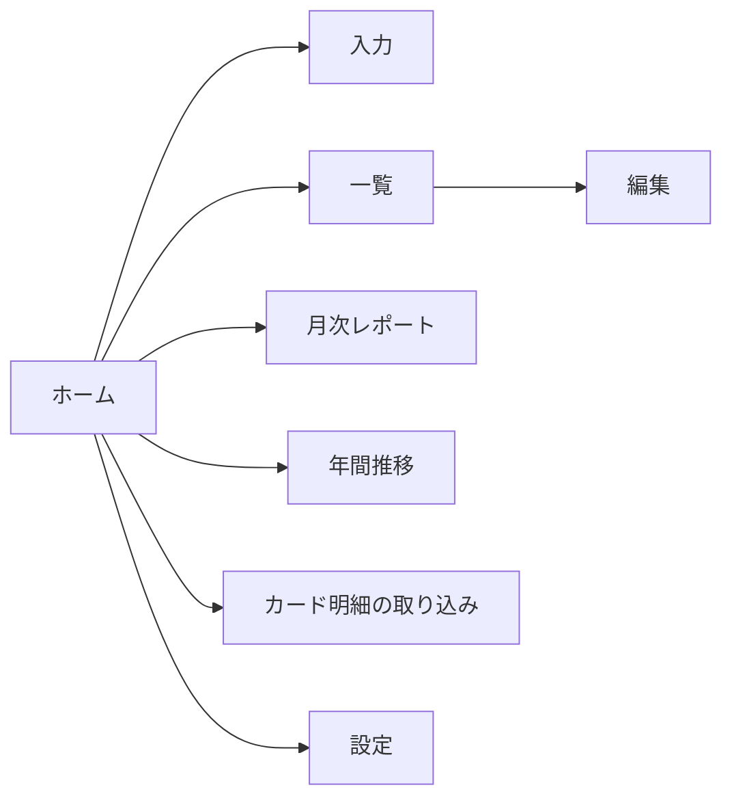

# 家計簿アプリ 要件定義書

2026年10月28日 · Daichi Nagata

> このリポジトリは公開しています。給与・貯蓄額・予算額・店名などの個人のお金の情報は、この文書には書かず、リポジトリの外（アプリのデータベースと `private/`）にだけ置きます。用語の意味は [GLOSSARY.md](GLOSSARY.md) に従います。

## 1. 概要

エクセルの家計簿の仕組み（予算設定・支出入力・月次レポート・年間推移）を引き継ぐWebアプリを作り、2026年11月1日からアプリに切り替えます。

- **背景**：Excelのサブスクリプションが終了し、エクセルの家計簿が使えなくなるため、代わりの仕組みが必要です。あわせて、手作業だったカード明細の転記と費目の振り分けを楽にします。
- **目的**：毎月の予算と実績を比べ、使いすぎた費目がすぐわかる状態を保つこと。貯蓄率と生活防衛資金の進み具合も追えるようにします。
- **対象範囲**：本人の家計（収入・支出・振替）。妻の支出は含めません。資産運用の時価管理や確定申告は対象外です。

## 2. 現行システム（エクセル）の分析

エクセルは5つのシートでできています。入力するのは「予算設定」と「入力」の2つだけで、ほかは自動で集計されます。

| シート | 役割 | 主な中身 |
| --- | --- | --- |
| 使い方 | 説明 | 操作手順、セルの色の意味 |
| 予算設定 | 入力（たまに） | 月の収入、費目ごとの月予算とメモ、生活防衛資金（開始時の貯蓄額と目標額） |
| 入力 | 入力（毎日） | 支出を1行1件で記録。日付・費目・内容・金額・支払方法・メモ |
| 月次レポート | 自動集計 | 指定した月の費目ごとの予算・実績・残り・消化率（予算オーバーは赤表示）、貯蓄率、生活防衛資金の達成率 |
| 年間推移 | 自動集計 | 開始月から12か月分の費目別実績とグラフ |

**エクセルの課題**

- カード明細の転記が手作業。三井住友カードの利用は月に約100件あり、費目の振り分けも毎回必要
- スマホからその場で入力しにくい
- 収入は予算額をそのまま使っていて、実際の入金額とは比べられない
- 「貯蓄・投資」を支出の費目として記録し、レポートで差し引いている
- 費目は14行に固定で、追加しにくい

## 3. お金の分類

アプリで記録するお金の動きは3種類です。

| 種類 | 内容 | 例 |
| --- | --- | --- |
| 支出 | 家計から出ていったお金。利用日の月に数える | 買い物、外食、家賃、妻へのお小遣い、カードの手数料・年会費 |
| 振替 | 置き場所が変わるだけで家計からは減っていないお金。支出の合計には含めない | 貯蓄・投資への移動 |
| 収入 | 家計に入ってきたお金。入金のたびに記録する | 給与（手取り）、妻からの入金 |

- **返金**：返品・取消は、元の買い物と同じ費目のマイナスの支出として記録します。
- **記録しないもの**：PayPay・Suicaへのチャージと、口座からのカード代金の引き落とし。お店で使った時点の支出だけを記録します。
- **月の区切り**：1日から月末までを1か月とします。給料日では区切りません。
- **家賃**：引き落とし日の月の支出とします。毎月1回分だけ入ります。
- **定期登録はしない**：家賃・給与・妻からの入金・振替も含めて、すべて手入力かカード明細の取り込みで記録します。

**費目（16個）**：家賃・食費（食材）・外食・水道光熱費・通信費・日用品・交通費・保険・医療費・被服・美容・交際費・趣味・娯楽・妻へのお小遣い・特別費・貯蓄・投資（振替）。

- 中食（コンビニ・惣菜）は食費（食材）に含めます。
- 自分の「お小遣い」の枠は設けず、すべて内容に合った費目に入れます。
- カードの手数料・年会費は特別費に入れます。

予算の初期値（2026年11月から適用）は個人情報のため `private/` にだけ置きます。予算合計は収入の予定額と同じにします（差額0が理想）。

## 4. 利用者と利用シーン

利用者は本人1人です。妻は使わず、妻の支出も記録しません。

1. 買い物や入金の直後に、スマホで支出・収入・振替を入力する（10秒以内）
2. 月に1〜2回、カード明細（CSV）を取り込み、「要確認」と「二重登録の候補」だけを見直す
3. 月末に月次レポートで予算オーバーの費目と貯蓄率を確認し、必要なら翌月の予算を調整する
4. 年に数回、年間推移で費目ごとの増え方を見て、固定費を見直す

## 5. 機能要件

| ID | 機能 | 内容 | 版 |
| --- | --- | --- | --- |
| F-01 | 予算設定 | 費目ごとの月予算と、収入の予定額を登録・変更する。予算合計と収入予定額の差額を表示する。変更はその月以降に適用し、過去の月の予算は変えない | 第1版 |
| F-02 | 費目の管理 | 費目の追加・名前変更・並べ替え・非表示。費目ごとに種類（支出／振替）を持つ。初期値は3章の16費目 | 第1版 |
| F-03 | 支出・振替の入力 | 日付（初期値は今日）・費目・金額は必須、内容・支払方法・メモは任意。費目「貯蓄・投資」を選ぶと振替として記録する。マイナスの金額（返金）も入力できる。スマホで数タップで入力できること | 第1版 |
| F-12 | 収入の入力 | 日付・収入の種類（給与／妻からの入金）・金額を記録する | 第1版 |
| F-04 | 一覧・修正・削除 | 月ごとに支出・振替・収入を一覧表示。費目・支払方法・「要確認」で絞り込み、内容で検索。複数件まとめて費目を変更できる | 第1版 |
| F-05 | 月次レポート | 費目ごとの予算・実績・残り・消化率。予算オーバーは赤で表示。収入は記録した実績と予定額を並べて表示し、記録がなければ実績は0円とする。支出合計・振替合計・未使用（収入−支出−振替）・貯蓄率（振替÷収入）のサマリー | 第1版 |
| F-06 | 生活防衛資金 | 開始時の貯蓄額と目標額を登録し、現在額（開始時の貯蓄額＋その月末までの振替の累計）・達成率（上限100%）・目標までの残りを表示する | 第1.1版 |
| F-07 | 年間推移 | 開始月から12か月分の費目別実績を表とグラフで表示。月平均は記録のある月の数で割る | 第1.1版 |
| F-11 | データの書き出し | 支出・振替・収入と予算をCSVで書き出す | 第1.1版 |
| F-08 | カード明細の取り込み | 三井住友カード（Vpass）のCSVを読み込み、支出として登録する。取り込み前に一覧で確認でき、件数と合計額を表示する。同じCSVの同じ明細は二重に登録しない | 第2版 |
| F-09 | 費目の自動振り分け | 「店名に含まれる言葉→費目」の振り分けルールで振り分ける。当てはまらないものは「要確認」にする。手で直したら、その店のルールとして覚えるかを選べる。店名の全角・半角、「ー」と「－」の違いは同じものとして扱う | 第2版 |
| F-16 | 二重登録の候補 | カード明細を取り込むとき、支払方法が同じカードの手入力の支出で、金額が同じかつ日付の差が3日以内のものを候補として表示する。手入力の分を残すか明細の分に置き換えるかを本人が選ぶ。勝手に削除はしない | 第2版 |
| F-15 | 他のカード・電子マネーの取り込み | エポスカード、Suica、PayPayの利用履歴を取り込む。Suicaは履歴をCSVで取り出せるかを確認し、できなければ手入力とする。チャージの行は取り込まない | 第3版 |
| F-14 | 予算オーバーの通知 | 消化率が80%・100%を超えた費目を通知する | 余裕があれば |

**作らないもの**：エクセルからの移行（F-10）と固定費の定期登録（F-13）。10月分のデータは、第2版で三井住友カードの10月のCSVを取り込んで登録し直します。

## 6. データ要件

金額はすべて税込みの円（整数）で扱います。

| データ | 項目 |
| --- | --- |
| 費目 | 名前、種類（支出／振替）、表示順、メモ、非表示フラグ |
| 予算 | 費目、適用開始月、月の予算額 |
| 収入の予定 | 収入の種類、適用開始月、月の予定額 |
| 支出・振替 | 日付、費目、内容、金額（返金はマイナス）、支払方法、メモ、要確認フラグ、登録元（手入力／明細取込）、取込元の明細ID、登録日時 |
| 収入 | 日付、収入の種類（給与／妻からの入金）、金額、メモ、登録日時 |
| 支払方法 | 名前（現金、クレジットカード、電子マネー、口座振替、その他）、カード・サービス名 |
| 振り分けルール | 店名に含まれる言葉、費目、要確認にするか、優先順 |
| 生活防衛資金 | 開始時の貯蓄額、目標額 |

- **二重登録の判定（同じCSVの中）**：同じ日に同じ店で同じ金額の利用は実際にあるため、「日付・店名・金額」に加えて、CSV内で何件目かも含めて判定します。
- **予算の履歴**：予算と収入の予定額には適用開始月を持たせ、過去の月は当時の値で表示します。

## 7. 非機能要件

| 区分 | 要件 |
| --- | --- |
| 作り | ブラウザで動くWebアプリ（ホーム画面に追加できる）。データはSupabase、公開はVercel（[ADR 0001](docs/adr/0001-web-app-on-supabase.md)） |
| 利用環境 | iPhoneとMacのブラウザ（Safari・Chrome）。スマホでの入力を最優先に作る |
| ログイン | Googleアカウントでログインし、本人のメールアドレス以外は入れない |
| 個人情報 | リポジトリは公開する。給与・予算額・貯蓄額・店名・カード明細（CSV）・エクセルはリポジトリに入れない。カード番号やVpassのID・パスワードはアプリにも保存しない |
| 通信 | すべて暗号化（HTTPS）する |
| バックアップ | 毎日自動でバックアップし、いつでも全データを書き出せる（F-11） |
| 量と速さ | 月150件・10年分（約18,000件）でも、画面表示とレポート集計は2秒以内。CSV 200件の取り込みは10秒以内 |
| 費用 | 有料ソフトの契約なしで使える。運用費は月500円以内（無料枠に収める） |

## 8. 画面一覧

| 画面 | 主な表示・操作 | 機能 |
| --- | --- | --- |
| ホーム | 今月の支出合計、残り予算、予算オーバーの費目、「要確認」の件数 | F-05 |
| 入力 | 支出・振替・収入の入力。続けて入力できる | F-03、F-12 |
| 一覧 | 月ごとの一覧、絞り込み、検索、まとめて費目変更 | F-04 |
| 編集 | 1件の修正と削除 | F-04 |
| 月次レポート | 予算と実績、サマリー、生活防衛資金 | F-05、F-06 |
| 年間推移 | 12か月分の費目別実績の表とグラフ | F-07 |
| カード明細の取り込み | CSVの選択、振り分け結果・要確認・二重登録の候補の確認と登録 | F-08、F-09、F-16 |
| 設定 | 予算・費目・収入の予定・振り分けルール・生活防衛資金・書き出し | F-01、F-02、F-06、F-09、F-11 |

## 9. リリース計画

1. **第1版：2026年11月1日**：F-01、F-02、F-03、F-12、F-04、F-05
    - 11月のカード利用は、第2版で明細を取り込むまで入力しなくてよい（現金・手渡し・収入・振替だけを手入力する）
2. **第1.1版：2026年11月中**：F-06、F-07、F-11
3. **第2版：2026年12月上旬**（11月分の明細を取り込む前）：F-08、F-09、F-16
    - 完了の目安：10月のCSVを取り込み、件数と合計額がVpassの明細合計と一致する
4. **第3版**：F-15。余裕があれば F-14

## 10. スコープ外・前提

- カード会社や銀行との自動連携（Vpassへの自動ログインやAPI連携）
- レシートの写真からの読み取り
- 株・NISAなどの時価や運用益の管理、確定申告の書類作成
- リボ払いの残高や毎月の返済額の管理（手数料だけは特別費として手入力する）
- 三井住友カードのCSVは、Vpassの明細画面の「CSV形式で保存する」から本人が取得する
- SupabaseとVercelのアカウントは本人が作成する
